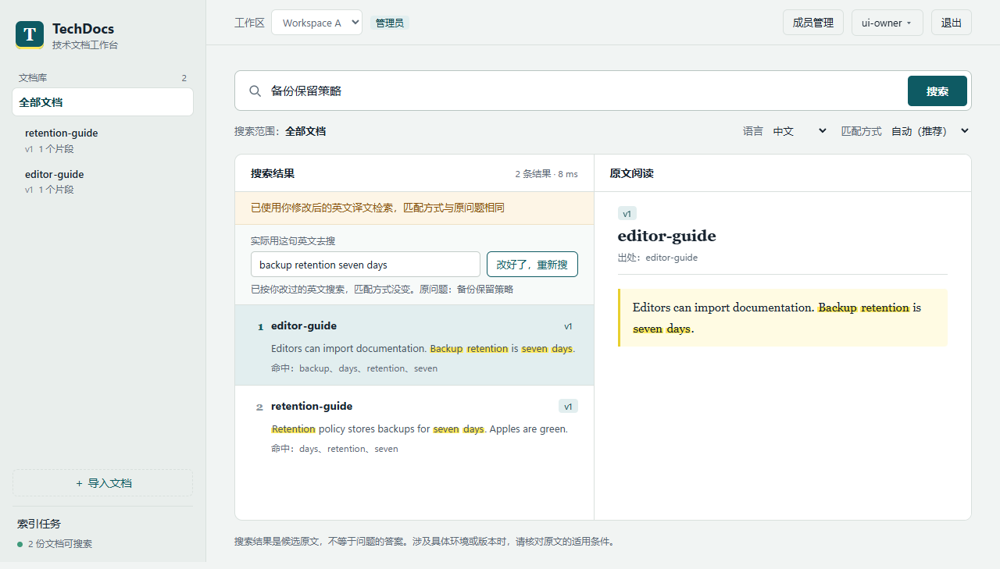

# TechDocs Hub

**用中文搜索英文技术文档，直接核对原文和版本。**

一个可在 Windows 本地运行的文档检索应用：支持中英文搜索、译文修正、文档版本与后台索引任务，以及按工作区隔离的多人权限。它返回可阅读的证据片段，不自动生成答案。



Python · FastAPI · SQLite · JavaScript · BM25 · E5 / OPUS-MT ONNX · pytest · Playwright

## 能做什么

- **跨语言检索**：中文问题先翻译再做 BM25；英文使用 BM25 与 E5 向量融合。可手动修改译文，保留原问题与检索方式。
- **版本与任务**：后台构建新索引，成功后原子切换；失败时旧版本仍可用，支持历史版本切回和服务重启恢复。
- **工作区权限**：owner / editor / viewer 三种角色；服务端校验资源归属，覆盖成员撤销、会话失效与缓存隔离。前端也处理工作区切换和迟到响应。
- **来源阅读**：显示片段、版本与来源；命中词高亮。低匹配仅提示核对，不把检索分数当成回答可信度。

## 运行本地演示

需要 Python 3.12、Git；完整双语检索还需下载约 258 MB 的固定模型资产。以下在仓库根目录执行（PowerShell）：

```powershell
python -m venv .venv
.\.venv\Scripts\python.exe -m pip install -r requirements.lock
.\.venv\Scripts\python.exe -B -m tools.download_models
.\.venv\Scripts\python.exe -B -m tools.setup_demo --data-dir ..\techdocs-demo-data
.\.venv\Scripts\python.exe -B -m tools.demo_launch --config ..\techdocs-demo-data\demo-config.json
```

打开 <http://127.0.0.1:8388>。用户名 `ui-owner`，密码见新建数据目录里的 `credentials.json`。这是随机演示凭据，`ui-editor` 与 `ui-viewer` 也可用于展示权限；不要上传这些文件。

首次登录后点击“导入文档”，导入 [backup-guide.md](examples/backup-guide.md)，文档标识填 `backup-guide`、版本填 `v1`。搜索“备份保留策略”；也可将英文译文改为 `backup retention seven days` 再搜索。新库没有内置官方文档，所以页面预设的 Redis / Docker 示例问题需先导入对应资料才有意义。

演示只监听本机，端口占用会拒绝启动。停止时在终端按 Ctrl+C；再次启动复用同一配置，**不要重新执行 setup_demo 覆盖数据**。已有模型可通过 `setup_demo --models-dir <模型目录>` 复用。详见 [运行与测试](docs/RUNNING.md)。

## 有哪些验证

| 范围 | 已有证据 | 如何理解 |
| --- | --- | --- |
| 后端工程 | 380 项测试 | 权限、会话、迁移完整性、事务与任务恢复；包含模拟模型单元测试 |
| 浏览器 | 20 + 13 + 11 = 44 项 | 真实登录与服务；部分网络/标签页事件由测试控制 |
| 冻结检索实验 | 英文 47/50，中文 42/50 | 前三条是否包含必要证据；不是问答准确率 |
| 性能对照 | 万片段英文 p50 约 340 → 67 ms | 历史 Windows 单并发、两轮对照，约降 80%；不代表生产吞吐 |

完整说明见 [验证证据与限制](docs/VALIDATION.md)。冻结语料没有随公开版分发，示例文档也不能复现上述检索指标。公开版不会展示一个并未实际运行的 CI 绿标。

## 看代码

```text
app/              API、账号、工作区、检索、任务与 Web 页面
tests/            后端测试、浏览器验收、性能对照参考实现
tools/            独立演示初始化、模型下载、测试运行工具
examples/         自写合成示例，不含官方文档语料
docs/             使用说明、架构、截图与验证摘要
fixtures/         固定模型版本与哈希清单
```

[架构与关键取舍](docs/ARCHITECTURE.md) · [测试入口](tests/browser/README.md) · [来源与发布范围](ATTRIBUTION.md)

这是个人项目，使用 Codex、Claude 辅助实现与交叉审查；需求范围、方案取舍和验收由项目作者确认。保留失败记录并依据复测决定合入，不宣称代码全部手写。

## 当前边界

支持 Markdown / 文本 / HTML 导入；主要面向英文文档。没有自动问答、PDF/OCR、自助注册或真实用户生产部署。当前完整版本的 Docker/Linux 运行仍未验收；Docker 文件保留用于配置契约测试，不作为已验证启动入口。不开放公共演示服务，本仓库链接用于查看源码与截图。

本公开版从本地已验收提交 `5e97c43` 整理，保留应用代码，移除私有材料，并适配测试路径。没有导入旧仓库历史、数据库、密码、模型权重或官方文档快照。
