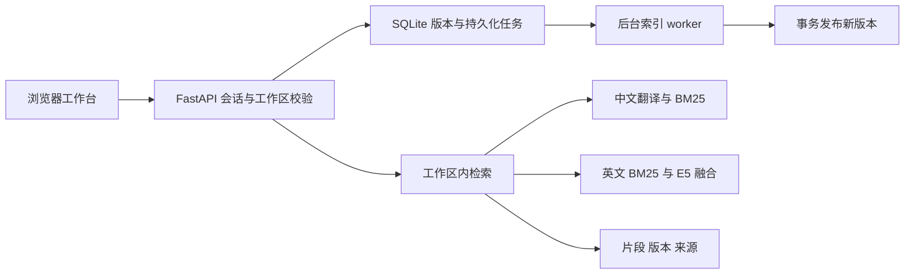

# 架构与关键取舍

## 检索

`app/search.py` 对关键词、向量及融合方案提供统一入口。中文先使用 OPUS-MT 翻译，再使用 BM25；英文默认融合词法与 E5 向量排序。手动译文仅替换词法查询，不改变原问题、语言和匹配方式。选择依据是固定题集上的方案对照，不因组件更多就默认采用混合方案。

向量候选成员判断从 list 改为 set，消除反复线性查找；稳定排序仍决定结果顺序。tests/reference 保留对照实现及哈希，tests/test_b1_equivalence.py 检查响应一致性。曾因一轮内存增幅超阈值回滚，随后复核和完整验收才合入；历史失败没有改写为通过。

## 任务与版本

`app/worker.py` 处理持久化任务，先完成片段及向量构建，再事务发布。失败不把不完整版本替换为当前版本；重启恢复任务。版本切换、删除、代际标识和缓存失效由存储层及检索层协作处理。

## 账号与工作区

`app/auth.py` 管理密码校验、会话和撤销；`workspace_api.py`、`workspace_store.py` 按工作区限定资源。owner 管理成员，editor 可编辑文档，viewer 只读。最后有效 owner 不能被移除或降级。权限在服务端校验，前端隐藏按钮只是交互辅助。

返回标签页时重新核验权限，核验完成前锁住操作。工作区切换或权限撤销后，过期请求不能把之前的文档、搜索结果或任务重新写回页面。

## 为什么不用自动问答

检索到相关片段与“证据足以支持完整回答”是两件事。当前版本让使用者阅读原文，不把检索评分包装成拒答或答案可靠性。SQLite 用于本地单机演示，不宣称多机并发或大规模生产能力。
